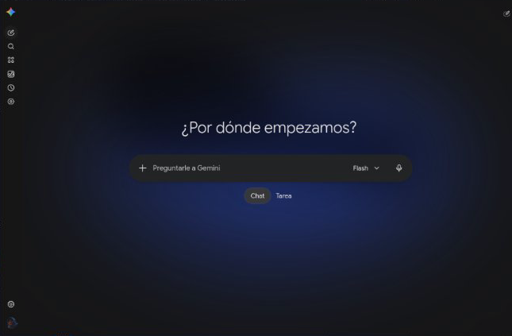
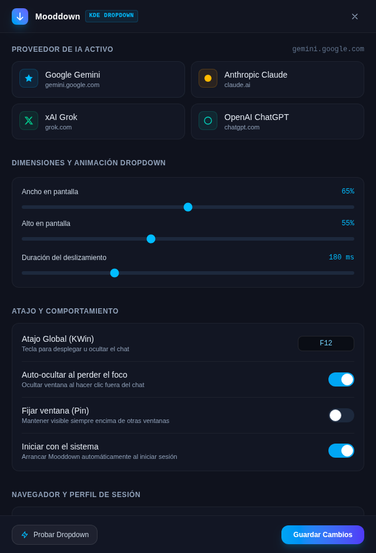

<p align="center">
  
</p>

<h1 align="center">Mooddown</h1>

<p align="center">
  <em>Quake/Yakuake-style Dropdown AI Chat Companion para KDE Plasma 6 (Wayland) y Windows.</em>
</p>

<p align="center">
  
  
  
  
</p>

---

**Mooddown** es una aplicación *dropdown* (al estilo clásico de Quake o Yakuake) siempre disponible mediante un atajo global de teclado (por defecto `Shift+F12` o `F12`), diseñada para desplegar instantáneamente a tu asistente de IA preferido (**Google Gemini**, **Anthropic Claude**, **xAI Grok** o **ChatGPT**) deslizándose suavemente desde el borde superior de tu pantalla.

---

## 📸 Capturas de Pantalla

### Dropdown AI Chat en Escritorio (KDE Plasma 6 Wayland)


### Ventana de Ajustes (Diseño Antigravity)
<p align="center">
  
</p>

---

## ✨ Características Principales

- 🎯 **Integración Nativa con KDE Plasma 6 (Wayland):** Utiliza un script de KWin 6 dedicado que responde en milisegundos a nivel de compositor gráfico sin bordes ni retrasos.
- 📐 **Redimensionamiento Interactivo en Tiempo Real:** Modifica el ancho y alto del dropdown arrastrando libremente sus bordes con el mouse (borde inferior con tirador flotante estilo Antigravity, laterales y esquinas). La geometría se sincroniza en vivo con KWin y se guarda de forma persistente en tu configuración.
- 🖱️ **Cursor-Follow Inteligente:** El panel desciende en la pantalla donde se encuentra tu cursor en configuraciones multimonitor.
- ⚡ **Modo Navegador Aislado (`--app`):** Carga las aplicaciones web oficiales completas mediante el navegador Chromium de tu sistema (Chrome, Brave, Chromium o Edge). Garantiza soporte total para cuentas de Google, extensiones de IA y audio/cámara, con mínimo consumo de memoria RAM.
- 🛡️ **Escudo Anti-Atajos de Navegador (CDP + KWin):** Bloquea atajos intrusivos del navegador (`Ctrl+N`, `Ctrl+T`, `Ctrl+W`, `Ctrl+J`, `Ctrl+H`, `Ctrl+P`, `Ctrl+S`, `Ctrl+U`, `F12`, etc.) y cierra automáticamente pestañas o ventanas secundarias emergentes para preservar una experiencia 100% de aplicación nativa.
- 🔒 **Perfil de Sesión Persistente:** Mantiene tus sesiones y cuentas iniciadas en un directorio local dedicado (`~/.local/share/mooddown/profile`), totalmente independiente de tu navegación web personal diaria.
- 📥 **Integración con Menú de Aplicaciones y Bandeja (Systray):** Incluye icono temático en la bandeja del sistema con menú contextual rápido y archivo `.desktop` compatible con KRunner y el menú de aplicaciones de KDE con acciones para alternar (*Toggle*), abrir configuración (*Settings*) o cerrar (*Quit*).
- 🎨 **Interfaz de Ajustes Estilo Antigravity:** Panel de configuración moderno en modo oscuro profundo, bordes sutiles de 1px, selectores táctiles, sliders reactivos y grabador visual de atajos de teclado globales.
- 📌 **Auto-Hide, Pin y Autostart:** Oculta automáticamente el chat al hacer clic fuera de él, fíjalo en pantalla (*Pin*) para tomar notas mientras trabajas, o configúralo para iniciar automáticamente con el sistema (XDG / Windows).

---

## 🚀 Requisitos

- **Linux:** KDE Plasma 6 (Wayland o X11) con herramientas D-Bus (`qdbus6` incluido por defecto en KDE Plasma 6).
- **Navegador:** Cualquier navegador basado en Chromium instalado en el sistema (`google-chrome-stable`, `brave-browser`, `chromium` o `microsoft-edge-stable`).
- **Windows:** Windows 10 u 11 (compatible con API Win32).

---

## 🛠️ Compilación y Uso

```bash
# 1. Clonar el repositorio
git clone https://github.com/davidbrum25/mooddown.git
cd mooddown

# 2. Instalar dependencias de frontend
npm install

# 3. Compilar interfaz de ajustes
npm run build

# 4. Compilar binario de producción optimizado en Rust
cd src-tauri
cargo build --release
cd ..

# 5. Ejecutar Mooddown
./run.sh
```

### Parámetros CLI soportados

```bash
# Abrir u ocultar el panel desplegable
mooddown --toggle

# Abrir ventana de configuración
mooddown --settings

# Cerrar el daemon y todas sus instancias
mooddown --quit
```

---

## ⚙️ Configuración (`config.toml`)

Mooddown administra automáticamente su configuración en `~/.config/mooddown/config.toml`:

```toml
[general]
provider = "gemini"               # "gemini" | "claude" | "grok" | "chatgpt" | "custom"
custom_url = "https://aistudio.google.com"
browser = "auto"                  # "auto" o ruta/comando específico
hotkey = "Shift+F12"              # Atajo global de invocación
autohide_on_blur = true           # Ocultar automáticamente al perder el foco
pinned = false                    # Fijar en pantalla
start_at_boot = true              # Iniciar automáticamente con el sistema

[providers]
gemini = "https://gemini.google.com"
claude = "https://claude.ai"
grok = "https://grok.com"
chatgpt = "https://chatgpt.com"

[window]
width_percent = 60                # Ancho del dropdown relativo a la pantalla (%)
height_percent = 60               # Alto del dropdown relativo a la pantalla (%)
animation_duration_ms = 180       # Duración de la animación de deslizamiento (ms)
target_screen = "cursor"          # Pantalla objetivo: "cursor" o "primary"
```

---

## 📄 Licencia

Distribuido bajo la Licencia [MIT](LICENSE).
